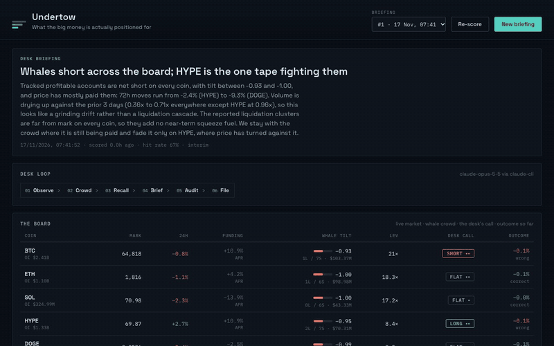
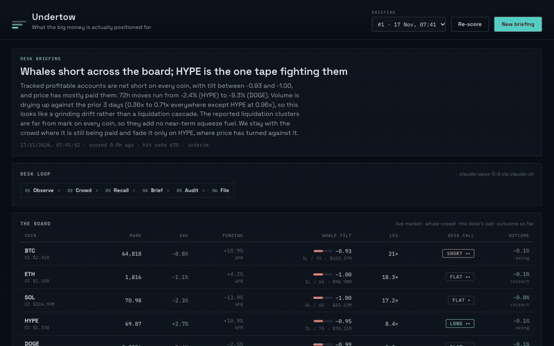
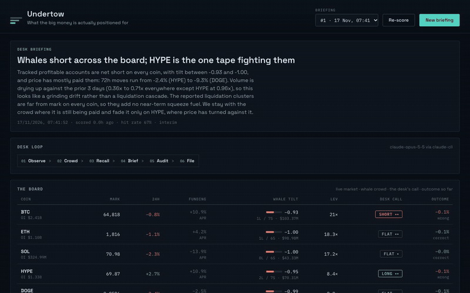
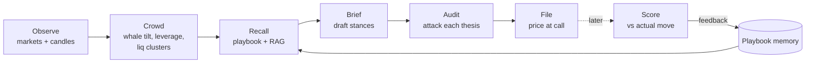

<div align="center">

# Undertow

**What the big money is actually positioned for, and whether the desk was right.**<br>
A positioning desk over live Hyperliquid whale data. It files a stance per coin, audits its own thesis, then scores the call against the market.


-4fd1c5)


[Demo](#demo) · [Features](#features-to-try) · [How it works](#how-it-works) · [Quick start](#quick-start) · [Tests](#tests)



</div>

---

## Why

Most "AI trading" demos stop at a confident paragraph. Undertow is built around the part they skip: **being
graded**. Every briefing is filed with the price at the time of the call, then scored against the move that
followed, and the result changes what the agent remembers.

| Weak spot of LLM market commentary | Undertow's countermeasure |
|---|---|
| Vibes instead of data | Every thesis must **cite a number it was given**: tilt, gross notional, leverage, funding, liquidation clusters |
| One-shot overconfidence | **Draft-then-audit.** A second pass attacks each thesis against the data and may downgrade or contradict it |
| Never checked afterwards | **Self-scoring** against the move since publication; `flat` is right inside a ±1.2% noise band |
| Lessons that don't stick | **Playbook memory** ranked by relevance × learned utility; lessons recalled before good briefings rise |
| "It was right, the market fell" | Reports the **move relative to BTC** next to the absolute verdict |

Read-only throughout: public Hyperliquid info API, no keys, no orders. Analysis tooling, not advice.

## Demo

<div align="center">

</div>

One briefing end to end: a headline, the desk loop, the board (mark, 24h, funding, whale tilt, leverage, desk call,
outcome), price chart, the audit, the scoreboard and the playbook.

## Features to try

### 1. Open any coin on the board for the thesis and its chart



Each row combines live market data with the **whale crowd** from the largest profitable accounts: net tilt, long
and short counts, gross notional and average leverage. Click a row for the desk's thesis and invalidation, and the
hourly price chart for that coin.

### 2. Watch the audit pass, the scoreboard and the playbook



The **audit** is a second model pass that checks each thesis against the numbers (in the demo run it flagged a
contradicted SOL thesis). The **scoreboard** shows interim and final hit rates, including the hit rate on
conviction 4+ calls. The **playbook** lists the lessons the desk has learned, with the utility each one earned.

## How it works



- **Computed, not recalled.** Net tilt, gross notional, average leverage and liquidation clusters come from
  `crowd_metrics`; 72h change, range position, realised vol and volume ratio from `structure`.
- **Scoring.** A directional call needs a move beyond a third of the 1.2% noise band in the right direction;
  `flat` is correct inside the band. Recalled lessons are credited or blamed once the briefing is an hour old.
- **RAG.** Cards on funding and crowding, liquidations and whales, and stance craft.

## Quick start

```bash
python3 -m venv .venv && source .venv/bin/activate
pip install -r requirements.txt          # needs git access to cacheycat/agentkit
python app.py                            # http://localhost:8813
```

The LLM layer uses `ANTHROPIC_API_KEY`, else a local headless `claude` CLI with tools disabled, else a deterministic
baseline briefing.

Working on both repos at once? Link a sibling checkout instead:

```bash
pip install fastapi uvicorn numpy certifi pydantic
ln -s ../agentkit/agentkit agentkit      # ignored by git
```

## API

| Method | Path | Purpose |
|---|---|---|
| GET | `/api/meta` | Provider mode, coins, scoring horizon |
| POST | `/api/brief` | Generate a briefing |
| POST | `/api/score/{run_id}` | Score a filed briefing against the move since |
| GET | `/api/history` | Past briefings with their scores |
| GET | `/api/candles` | Hourly candles for a coin |
| GET | `/api/memory` | Playbook lessons with learned utility |
| GET | `/api/runs`, `/api/runs/{id}`, `/api/runs/{id}/events` | Run list, detail, replayable SSE trace |

## Tests

```bash
pip install -r requirements-dev.txt
pytest -q && ruff check .
```

## Part of a set

Built on [agentkit](https://github.com/cacheycat/agentkit), alongside
[holdout](https://github.com/cacheycat/holdout) (blind strategy research) and
[casefile](https://github.com/cacheycat/casefile) (on-chain investigation).

> It never places orders. A stance is a hypothesis to be scored, not a trade.
